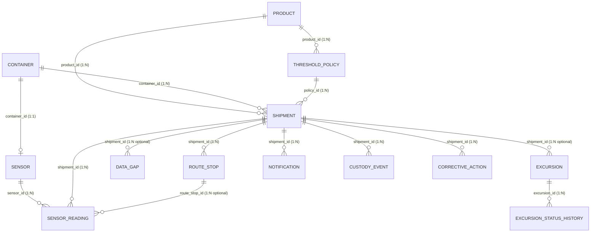
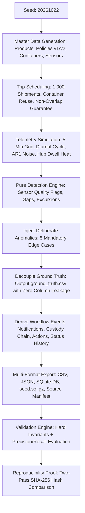

# Cold-Chain Telemetry & Excursion Synthesis: End-to-End System Guide

This document provides a complete technical explanation of the **YottaFlex AI Candidate Project**, comparing the original problem brief provided in the recruiting portal against the implemented solution, its pipeline, workflow architecture, and requirement compliance.

---

## 1. Executive Summary

- **Project Goal**: Build an industrial-grade, fully reproducible synthetic data generator and validation engine for cold-chain logistics monitoring (temperature and humidity telemetry along storage and transport journeys).
- **Core Challenge**: Model 1,000 shipments, 300 containers, and ~1,000,000 5-minute telemetry readings across 13 relational entities, inject realistic physical variations and 5 mandatory edge-case defects, enforce append-only chain-of-custody and multi-actor workflows, and prove data integrity and defect detection with mathematical precision (Precision = 1.0, Recall = 1.0, 0 hard invariant failures).
- **Implementation Status**: **100% complete, fully verified, reproducible, and self-contained.**

---

## 2. What Was Provided in the Brief (Problem Statement & Requirements)

The problem specification provided by YottaFlex AI consists of:

### 2.1. Business Context & Objective
- **Problem**: Monitor temperature and humidity along storage and transport journeys and manage excursions with evidence.
- **Objective**: Build a working, executable end-to-end workflow solution that exposes key decisions and exceptions, preserves traceability, produces measurable outputs, models multiple related entities and conditional business rules, and implements at least one exception path with meaningful evaluation metrics.

### 2.2. Primary Actors / Systems
The brief defines four operational roles plus IT/OT systems:
1. **Plant Operator**: Monitors real-time departures, logs brief excursions, acknowledges initial alarms.
2. **Quality / Maintenance Engineer**:
   - *Quality Engineer*: Reviews prolonged and critical excursions, enforces quarantine/holds, decides final disposition (`RELEASE` vs. `REJECT`).
   - *Maintenance Engineer*: Inspects reefer units on refrigeration failure when deviations occur without route delays.
3. **Production Planner**: Notified on critical product rejections to replan replacement shipments; replans deliveries when route delays occur.
4. **OT / IT Administrator**: Receives alerts for prolonged sensor dropouts (telemetry gaps >= 30 min) and low-trust expired calibration events.

### 2.3. The 10 Granular Generation Steps Required by the Brief
1. **Step 1 — Data Dictionary**: Document Product, Shipment, Container, Sensor, SensorReading, RouteStop, ThresholdPolicy, Excursion, CustodyEvent, CorrectiveAction with type, nullability, units, uniqueness, allowed values, and validation rules.
2. **Step 2 — Hierarchical Master & Event Tables**: Generate parent/master tables first, then child transaction and event tables with valid parent foreign keys.
3. **Step 3 — Deterministic Nomenclature**:
   - Shipment: `SHP-2026-000001`
   - Container: `CNT-000001`
   - Sensor: `SNS-CNT-000001-TEMP`
   - Reading: `RDG-<sensor-id>-<timestamp>`
   - Excursion: `EXC-2026-000001`
   - Immutable, zero-padded, and strictly consistent foreign keys.
4. **Step 4 — Baseline Scale & Determinism**:
   - 1,000 shipments, 300 containers, 5-minute readings over 2–5 day trips (~1.0 M readings).
   - Fixed seed (`20261022`) with parameterized scale (`starter` = 50 shipments, `full` = 1,000 shipments).
5. **Step 5 — The 5 Mandatory Edge Cases (Deliberate Anomalies)**:
   1. *Reading outside physical range*: Unphysical telemetry (e.g., -127 °C or 150 °C) that hardware cannot produce.
   2. *Missing interval interpreted as safe*: Sensor dropouts/gaps flagged as `UNVERIFIED` rather than assumed safe.
   3. *Shipment delivered before departure*: Corrupted date ordering (`actual_departure > actual_arrival`).
   4. *Threshold applied to wrong product*: Policy applied to a product it does not govern.
   5. *Excursion duration undercounted*: Stored duration artificially shortened compared to raw readings.
   - *Additional scenarios*: Calibration expiration, stuck sensors, and route delays.
6. **Step 6 — Derived Values Recomputed from Source Records**: Totals, durations, severity, and shipment outcomes must be computed from raw readings using documented business logic—never drawn as independent random labels.
7. **Step 7 — Decoupled Ground Truth**: Produce a separate `ground_truth.csv` and `ground_truth.json` containing known defects and expected decisions. **Never leak ground-truth labels into input features.**
8. **Step 8 — Validation Suite**: Validate PK uniqueness, FK integrity, enum constraints, date ordering, arithmetic consistency, container non-overlap, and lifecycle transitions.
9. **Step 9 — Multi-Format Export**: Export CSV, JSON, SQLite (`coldchain.db`), compressed SQL dump (`seed.sql.gz`), source manifest (`source_manifest.json`), checksums (`checksums.json`), and validation summary.
10. **Step 10 — Reproducibility Demonstration**: Run generation twice with the same seed and compare row counts and uncompressed SHA-256 hashes.

---

## 3. What We Made (Solution Architecture)

We built **`coldchain-synth`**, a self-contained Python package using NumPy, Pandas, and Python’s built-in `sqlite3`. It contains zero external service dependencies and runs entirely offline.

```
cold-chain-synth/
├── src/coldchain/
│   ├── schema.py          # Single source of truth: 13 entities, DDL, data dictionary, ERD
│   ├── config.py          # Volumes, seed (20261022), defect rates, scenario mix
│   ├── timeutil.py        # Epoch-minute arithmetic, ISO-8601 UTC conversions
│   ├── master_data.py     # 8 products, 16 threshold policies (v1/v2), 300 containers, 300 sensors
│   ├── scheduling.py      # Non-overlapping container reuse, route stops, delay injection
│   ├── readings.py        # 5-min telemetry generation: thermal setpoint + diurnal drift + AR(1) + hub heat
│   ├── detection.py       # Pure detection engine: quality flags, gap detector, excursion runs
│   ├── rules.py           # Mathematical severity formulas, notification/action routing, state transitions
│   ├── workflow.py        # Notifications, custody events, corrective actions, status history
│   ├── generate.py        # 10-step orchestrator, defect injection, ground-truth generation
│   ├── export.py          # CSV, JSON, SQLite DB, seed.sql.gz, source manifest, checksums
│   ├── validate.py        # Hard invariant checker + ground-truth precision/recall evaluator
│   └── cli.py             # CLI commands: generate, validate, reproduce, docs
├── tests/
│   ├── test_detection.py  # Unit tests for duration (+5 min rule), boundary inclusivity, gaps, stuck sensors
│   ├── test_generator.py  # Seed determinism, FK integrity, container non-overlap, scale presets
│   └── test_validation.py # Mutation tests: corrupts data (tampered PK, bad FK, leaked columns) to prove detector catches all
├── docs/
│   ├── data_dictionary.md # Field-level data dictionary (types, units, formats, rules)
│   ├── erd.md             # Mermaid ERD diagram + Cardinality and Lifecycle matrices
│   └── PROJECT_EXPLANATION.md # This comprehensive document
├── ai_usage/
│   └── PROMPT_HISTORY.md  # AI-use disclosure and verbatim prompt log (guideline 03)
├── data/
│   ├── starter/           # 50 shipments, 15 containers, 50k readings (fast testing)
│   └── full/              # 1,000 shipments, 300 containers, ~1M readings; SQL as `schema.sql` + `seed.sql.gz` (the 240 MB `coldchain.db` is rebuilt locally)
├── pyproject.toml         # Build metadata and console entry point `coldchain`
├── requirements.txt       # numpy>=1.26, pandas>=2.1, pytest>=8.0
└── README.md              # Setup, usage, and architectural rationale
```

---

## 4. The 13 Relational Entities & Data Model

The system implements 13 strongly-typed entities connected by foreign keys and documented cardinalities:



### Entity Cardinality & Function Matrix

| Entity | Primary Key | Foreign Keys | Cardinality | Purpose |
|---|---|---|---|---|
| **`product`** | `product_id` (`PRD-0001`) | None | 1 : N to Policy & Shipment | Master catalog of pharmaceuticals, vaccines, and frozen/chilled food products. |
| **`threshold_policy`** | `policy_id` (`POL-000001`) | `product_id` | 1 : N from Product | Permissible temperature/humidity limits, max excursion minutes, and critical margins. Has 2 versions with effective dates. |
| **`container`** | `container_id` (`CNT-000001`) | None | 1 : 1 with Sensor, 1 : N with Shipment | Physical reefer container or insulated shipper reused sequentially across trips. |
| **`sensor`** | `sensor_id` (`SNS-CNT-000001-TEMP`) | `container_id` | 1 : 1 with Container | Combined temperature/humidity telemetry logger calibrated (about 5 % of sensors have a lapsed calibration during the year). |
| **`shipment`** | `shipment_id` (`SHP-2026-000001`) | `product_id`, `container_id`, `policy_id` | Parent to all event tables | A transport journey moving a product in a container from origin to destination (2–5 days). |
| **`route_stop`** | `route_stop_id` (`RST-SHP-...-01`) | `shipment_id` | 1 : N from Shipment | Ordered route milestones: origin, 1–3 transit hubs, and destination. Tracks planned vs actual arrival/departure and delay minutes. |
| **`sensor_reading`** | `reading_id` (`RDG-SNS-...-ts`) | `sensor_id`, `shipment_id`, `route_stop_id` | 1 : N from Sensor & Shipment | 5-minute telemetry records with `temperature_c`, `humidity_pct`, and `quality_flag`. |
| **`data_gap`** | `gap_id` (`GAP-2026-000001`) | `shipment_id`, `sensor_id` | 1 : N from Shipment | Logged telemetry dropout where readings are missing (> 5 min cadence). Flagged `UNVERIFIED`. |
| **`excursion`** | `excursion_id` (`EXC-2026-000001`) | `shipment_id`, `sensor_id`, `policy_id` | 1 : N from Shipment | Maximal run of consecutive out-of-range readings. Stores duration, peak value, peak deviation, severity, and cause. |
| **`excursion_status_history`** | `history_id` (`ESH-2026-000001`) | `excursion_id` | 1 : N from Excursion | Append-only audit trail capturing lifecycle state changes, timestamps, and actor roles. |
| **`notification`** | `notification_id` (`NTF-2026-000001`) | `shipment_id`, `trigger_id` (polymorphic) | 1 : N from Shipment | System alerts delivered via DASHBOARD, EMAIL, or SMS to specific operational actors. |
| **`custody_event`** | `custody_id` (`CUS-2026-000001`) | `shipment_id` | 1 : N from Shipment | Chronological chain-of-custody handoffs (`PICKUP`, `STOP_ARRIVAL`, `QUALITY_HOLD`, `RELEASE`/`REJECT`, `DELIVERY`). |
| **`corrective_action`** | `action_id` (`CA-2026-000001`) | `shipment_id`, `trigger_id` (polymorphic) | 1 : N from Shipment | Remedial tasks assigned to roles with created timestamp, SLA due date, completed timestamp, and outcome (`COMPLETED`/`OPEN`). |

---

## 5. End-to-End Pipeline & Workflow Execution

The generation and validation pipeline operates deterministically in 10 sequential phases:



### 5.1. Phase 1 & 2: Master Data & Scheduling
1. **Master Data (`master_data.py`)**:
   - 8 realistic pharmaceutical and food products (e.g., mRNA Vaccine, Biologic Injection, Fresh Berry Produce).
   - 16 threshold policies (2 versions per product). Version 1 is effective `2025-01-01` to `2026-06-30`; Version 2 is stricter and effective from `2026-07-01` onwards.
   - 300 physical containers and calibrated sensors (`SNS-CNT-000001-TEMP`).
2. **Scheduling (`scheduling.py`)**:
   - 1,000 shipments distributed across 293 active containers (~3.4 trips per container).
   - An interval scheduling algorithm guarantees **zero container overlaps**, enforcing at least a **12-hour turnaround buffer** between consecutive trips for container cleaning and pre-cooling.
   - Trips last 2.0 to 5.0 days across 1 to 3 intermediate transit hubs.

### 5.2. Phase 3 & 4: Physics Telemetry Simulation & Pure Detection
1. **Telemetry Generation (`readings.py`)**:
   - Grid: Strict 5-minute sampling intervals.
   - Physics Model: Baseline temperature sits at the policy midpoint. Realistic variations are layered on:
     $$\text{Temp}(t) = T_{\text{setpoint}} + A_{\text{diurnal}} \sin\left(\frac{2\pi t}{1440}\right) + \epsilon_{\text{AR(1)}}(t) + \Delta T_{\text{hub\_door}}(t)$$
   - Transit hub stops simulate trailer door-open warming with exponential recovery.
2. **Pure Detection (`detection.py`)**:
   - Quality classification:
     - `SENSOR_FAULT`: Readings outside physical hardware range (Temperature < -50 °C or > 85 °C; Humidity < 0% or > 100%).
     - `LOW_TRUST`: Sensor flat-lined (stuck at identical temperature/humidity for >= 12 consecutive readings = 60 min) or sensor calibration expired prior to departure.
     - `GOOD`: Valid telemetry.
   - Gap detection: Steps > 5 minutes between readings are recorded as `data_gap` with status `UNVERIFIED`.
   - Excursion runs: Runs of consecutive out-of-range readings that **never bridge gaps or sensor faults**.

### 5.3. Phase 5: Excursion Severity & Mathematical Rules
In `rules.py`, excursion duration follows the industrial time-grid convention:
$$\text{Duration} = (T_{\text{last\_bad}} - T_{\text{first\_bad}}) + 5\text{ minutes}$$
*(A single isolated out-of-range reading represents 5 full minutes of excursion).*

Classification logic:
- **`BRIEF`** (Tolerated): $\text{Duration} \le \text{Max Excursion Minutes}$. (Boundary inclusive).
- **`PROLONGED`** (Quality Breach): $\text{Duration} > \text{Max Excursion Minutes}$.
- **`CRITICAL`** (Product Compromised): $\text{Duration} \ge 3 \times \text{Max Excursion Minutes}$ **OR** $\text{Peak Deviation} \ge \text{Critical Margin}$ (5 °C or 12 %RH).

### 5.4. Phase 6 & 7: Anomaly Injection & Isolated Ground Truth
The 5 mandatory edge cases are injected into a small controlled fraction of records:

| Anomaly Code | Injection Mechanism | Detection Logic | Expected Decision |
|---|---|---|---|
| `OUT_OF_PHYSICAL_RANGE` | Telemetry corrupted to -127 °C or 150 °C away from events. | Value outside probe physical limits. | `FLAG_SENSOR_FAULT_AND_EXCLUDE_FROM_EXCURSIONS` |
| `SENSOR_DROPOUT_GAP` | 1–3 gaps of 3–40 readings dropped in 8% of shipments. | Time delta between readings > 5 min. | `FLAG_UNVERIFIED_DO_NOT_TREAT_AS_SAFE` |
| `DELIVERY_BEFORE_DEPARTURE` | `actual_departure` and `actual_arrival` swapped on 1.5% of shipments. | `actual_departure > actual_arrival`. | `REJECT_RECORD_DATE_ORDER` |
| `WRONG_POLICY` | `policy_id` swapped with another product's policy on 1.5% of shipments. | `shipment.product_id != policy.product_id`. | `REJECT_RECORD_POLICY_MISMATCH` |
| `DURATION_UNDERCOUNTED` | Stored `duration_minutes` reduced by 15–50% on 5% of excursions. | Stored duration != recomputed duration from readings. | `RECOMPUTE_DURATION_FROM_READINGS` |

**Zero Leakage Guarantee**:
Known anomalies and expected decisions are written exclusively to `ground_truth.csv` and `ground_truth.json`. No `anomaly_type`, `is_defect`, or label columns exist in any input table (proven by validator check `schema.no_leakage`).

### 5.5. Phase 8: Multi-Actor Event Workflow
In `workflow.py`, downstream operational events are derived directly from physical facts:
1. **Notifications**:
   - `BRIEF` excursion $\rightarrow$ Plant Operator (INFO, Dashboard).
   - `PROLONGED` excursion $\rightarrow$ Plant Operator + Quality Engineer (WARNING, Email).
   - `CRITICAL` excursion $\rightarrow$ Plant Operator + Quality Engineer + Production Planner (CRITICAL, SMS).
   - Prolonged Gap ($\ge 30$ min) or Expired Calibration $\rightarrow$ OT/IT Admin (WARNING).
2. **Corrective Actions**:
   - Automatically raised with SLA deadlines (e.g., `QUALITY_HOLD_REVIEW` due in 48h; `REPLAN_REPLACEMENT_SHIPMENT` due in 72h; `INSPECT_REEFER_UNIT` due in 72h).
3. **Append-Only Status History**:
   - Status changes are recorded as new rows in `excursion_status_history` (`OPEN` $\rightarrow$ `ACKNOWLEDGED` $\rightarrow$ `UNDER_REVIEW` $\rightarrow$ `RELEASED` / `REJECTED`). History is never overwritten.
4. **Chain of Custody**:
   - Sequential custody handoffs: `PICKUP` (Plant $\rightarrow$ Carrier) $\rightarrow$ `STOP_ARRIVAL` / `STOP_DEPARTURE` $\rightarrow$ `QUALITY_HOLD` (if excursion occurs) $\rightarrow$ `RELEASE` / `REJECT` $\rightarrow$ `DELIVERY`.

### 5.6. Phase 9 & 10: Multi-Format Export, Validation & Reproducibility
- **Exports (`export.py`)**:
  - CSV files (gzipped for readings).
  - JSON and JSONL exports.
  - Full relational SQLite database (`coldchain.db`) with foreign key constraints enabled.
  - Compressed SQL dump (`seed.sql.gz`) containing DDL and full insert statements.
  - `source_manifest.json` recording command, seed, and data provenance.
  - `checksums.json` storing SHA-256 hashes of all uncompressed files.
- **Validation Suite (`validate.py`)**:
  - Runs independent re-derivation from raw readings without trusting stored fields.
  - Checks hard invariants (PK uniqueness, FK integrity, SQLite `PRAGMA foreign_key_check`, date ordering, 5-minute cadence).
  - Matches detected defects against `ground_truth.csv`: **Precision = 1.0, Recall = 1.0 (828 ground-truth anomalies detected with 0 false positives and 0 false negatives).**
- **Reproducibility Test (`cli.py reproduce`)**:
  - Runs two full generation cycles into separate temporary directories and verifies that every output file produces identical row counts and identical SHA-256 checksums.

---

## 6. Exact Requirements vs. Implementation Compliance Matrix

| Requirement from Brief / Screenshots | How It Is Addressed in Solution | Source Code Reference |
|---|---|---|
| **1,000 Shipments & 300 Containers** | Baseline volume generates exactly 1,000 shipments across 293 active containers with container reuse. | [`config.py:SCALES["full"]`](../src/coldchain/config.py#L22) |
| **5-Minute Telemetry Cadence** | Continuous readings generated every 5 minutes along 2–5 day trips (~1,000,000 total readings). | [`rules.py:INTERVAL = 5`](../src/coldchain/rules.py#L4) |
| **Deterministic Seed (e.g. 20261022)** | Uses fixed seed `20261022` with independent spawned NumPy `SeedSequence` streams. | [`config.py:DEFAULT_SEED`](../src/coldchain/config.py#L6) |
| **Data Dictionary (Step 1)** | Complete field specification with types, nullability, units, and validation rules. | [docs/data_dictionary.md](../docs/data_dictionary.md) |
| **Deterministic IDs (Step 3)** | `SHP-2026-000001`, `CNT-000001`, `SNS-CNT-000001-TEMP`, `RDG-...`, `EXC-2026-000001`. | [`schema.py`](../src/coldchain/schema.py#L40-L240) |
| **Edge Case 1: Physical Range** | Corrupted readings (-127 °C, 150 °C) flagged `SENSOR_FAULT` and excluded from excursions. | [`readings.py:inject_faults()`](../src/coldchain/readings.py) |
| **Edge Case 2: Missing Interval Safe** | Dropouts flagged `UNVERIFIED` in `data_gap`; gaps are never treated as safe. | [`detection.py:find_gaps()`](../src/coldchain/detection.py#L44) |
| **Edge Case 3: Delivery Before Departure** | Timestamps swapped; caught by date order invariant. | [`generate.py:inject_defects()`](../src/coldchain/generate.py) |
| **Edge Case 4: Wrong Product Policy** | Another product's threshold policy applied (a valid FK with the wrong meaning); caught by the policy product / effective-date check. | [`generate.py:inject_defects()`](../src/coldchain/generate.py) |
| **Edge Case 5: Duration Undercounted** | Duration tampered by 15–50%; caught by recomputing duration from raw readings. | [`generate.py:inject_defects()`](../src/coldchain/generate.py) |
| **Decoupled Ground Truth (Step 7)** | Decoupled `ground_truth.csv`/`json`; zero columns leaked to input tables. | [`validate.py:schema.no_leakage`](../src/coldchain/validate.py#L99) |
| **Multi-Actor Operational Workflow** | Plant Operator, Quality Engineer, Maintenance Engineer, Production Planner, OT/IT Admin. | [`workflow.py:build()`](../src/coldchain/workflow.py#L10) |
| **Append-Only Event History** | `excursion_status_history` records state changes as new rows; no history overwrites. | [`workflow.py:hist.append()`](../src/coldchain/workflow.py#L56) |
| **Reproducibility Test (Step 10)** | `coldchain reproduce` validates identical row counts and SHA-256 hashes across runs. | [`cli.py:cmd_reproduce()`](../src/coldchain/cli.py#L50) |
| **AI Transparency (Guideline 03)** | Accurate AI-use disclosure and verbatim prompt log documented. | [ai_usage/PROMPT_HISTORY.md](../ai_usage/PROMPT_HISTORY.md) |

---

## 7. How to Execute and Verify the Solution

### 7.1. Quick Start (Windows, macOS, Linux)
```bash
# 1. Install package in editable mode
pip install -e .

# 2. Run the full automated test suite (38 unit & mutation tests)
pytest

# 3. Generate starter dataset (50 shipments, 15 containers)
coldchain generate --scale starter --out data/starter

# 4. Generate full dataset (1,000 shipments, 300 containers, ~1M readings)
coldchain generate --scale full --out data/full

# 5. Validate the generated dataset
coldchain validate --data data/full --write

# 6. Verify deterministic reproducibility (Two independent generation passes)
coldchain reproduce --scale starter
```

### 7.2. Test Suite Breakdown
The test suite in [`tests/`](../tests) includes **38 comprehensive tests**:
- **Unit Tests**: Verifies duration calculation (`+5 min` rule), boundary classification (`BRIEF` vs `PROLONGED`), sensor fault exclusion, stuck sensor run-length encoding.
- **Property Tests**: Verifies seed determinism, foreign key integrity, non-overlapping container scheduling.
- **Mutation Tests**: Deliberately corrupts datasets (e.g., injects duplicate PK, bad FK, altered reading values, deleted gap row, leaked ground-truth column) to prove that the validation engine detects every single defect and rejects invalid datasets.

### 7.3. Expected Verification Output
```
$ pytest
============================= 38 passed in ~12s =============================

$ coldchain validate --data data/full
PASS  hard_failures=0  precision=1.0 recall=1.0

$ coldchain reproduce --scale starter
[run_a] generating ...
[run_b] generating ...
  OK  container.csv                      rows=       15  b36810f2a578622f
  OK  excursion.csv                      rows=       19  6ee54ec43eac0f16
  OK  sensor_reading.csv.gz              rows=   50,959  3c9b26b9aa873ffb
  ... (all 30 files match)
REPRODUCIBLE: identical row counts and checksums
```

---

## 8. Summary of Engineering Highlights

1. **Zero-Leakage Architecture**: Ground-truth records are completely decoupled from training/input tables, ensuring downstream ML models cannot cheat.
2. **Deterministic NumPy Streams**: Uses `np.random.SeedSequence.spawn` to guarantee identical numerical output across operating systems without relying on fragile global random state.
3. **High Performance**: Generates, serializes, and validates 1,000,000 rows in ~40 seconds on standard laptop hardware using vectorized NumPy and Pandas routines.
4. **Industrial-Grade Data Integrity**: Every relationship is verified by database foreign key constraints (`PRAGMA foreign_key_check`), field-level regular expressions, and date order checks.
