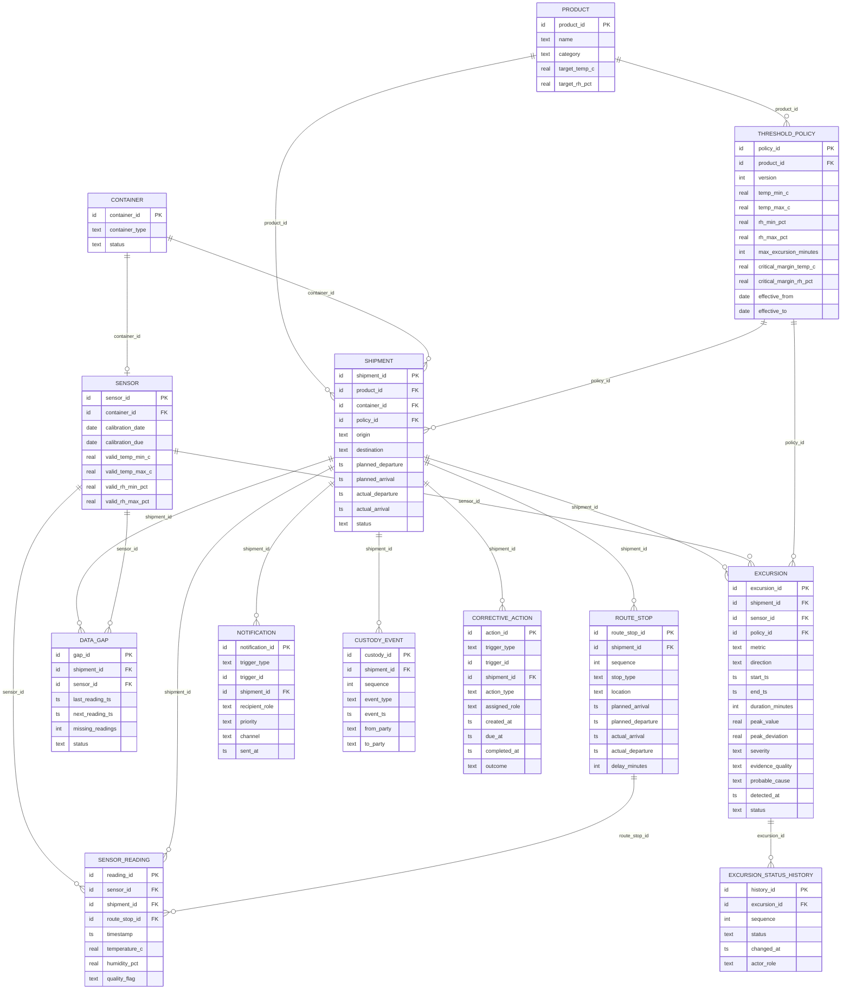

# Entity-relationship diagram

`notification.trigger_id` and `corrective_action.trigger_id` are polymorphic references (excursion / data gap / shipment / route stop) selected by `trigger_type`; they are validated by `coldchain validate` instead of a SQL foreign key.

---

## Entity Relationships & Cardinality Summary

| Parent Entity | Child Entity | Foreign Key | Cardinality | Relationship Nature / Description |
|---|---|---|---|---|
| `PRODUCT` | `THRESHOLD_POLICY` | `product_id` | **1 : N** | One product has multiple policy versions (v1, v2) with effective date windows. |
| `CONTAINER` | `SENSOR` | `container_id` | **1 : 1** | One combined temp/humidity logger attached per container. |
| `PRODUCT` | `SHIPMENT` | `product_id` | **1 : N** | One product type is transported across many shipments. |
| `CONTAINER` | `SHIPMENT` | `container_id` | **1 : N** | A physical container is reused across ~3.4 sequential shipments (non-overlapping). |
| `THRESHOLD_POLICY` | `SHIPMENT` | `policy_id` | **1 : N** | Bound by `product_id` and effective date at shipment planned departure. |
| `SHIPMENT` | `ROUTE_STOP` | `shipment_id` | **1 : N** | Ordered route sequence (origin, 1–3 transit hubs, destination). |
| `SENSOR` | `SENSOR_READING` | `sensor_id` | **1 : N** | Continuous 5-minute telemetry readings recorded by the container's probe. |
| `SHIPMENT` | `SENSOR_READING` | `shipment_id` | **1 : N** | Readings scoped to the active transit window of the shipment. |
| `ROUTE_STOP` | `SENSOR_READING` | `route_stop_id` | **1 : N (optional)** | Set while container is dwell-logged at a stop; `NULL` while in transit. |
| `SHIPMENT` | `DATA_GAP` | `shipment_id` | **1 : N (optional)** | Gaps where reading cadence > 5 min; flagged `UNVERIFIED`. |
| `SHIPMENT` | `EXCURSION` | `shipment_id` | **1 : N (optional)** | Maximal consecutive out-of-range runs detected for the shipment. |
| `EXCURSION` | `EXCURSION_STATUS_HISTORY` | `excursion_id` | **1 : N** | Append-only audit log tracking lifecycle state transitions over time. |
| `SHIPMENT` | `NOTIFICATION` | `shipment_id` | **1 : N** | Role alerts routed to plant operator, quality, maintenance, planner, OT/IT. |
| `SHIPMENT` | `CUSTODY_EVENT` | `shipment_id` | **1 : N** | Chronological chain-of-custody handoffs and disposition milestones. |
| `SHIPMENT` | `CORRECTIVE_ACTION` | `shipment_id` | **1 : N** | Tracked remedial tasks with roles, due dates, and completion status. |

---

## Many-to-many relationships

- **Product N:M Container** (a container carries different products over time; a product travels in many containers) is resolved by `SHIPMENT`, the bridge/association table. It carries `product_id`, `container_id`, `policy_id`, the route, times and status, so no separate join table is needed.
- All other relationships are 1:1 (`CONTAINER`-`SENSOR`) or 1:N, some optional (`SHIPMENT` > `EXCURSION`, `DATA_GAP`, `NOTIFICATION`, `CORRECTIVE_ACTION`).

---

## Lifecycle States & Effective Dates

### Effective Dates
- **`threshold_policy.effective_from` & `effective_to`**: Version 1 is active from `2025-01-01` to `2026-06-30`. Version 2 introduces tighter tolerance windows active from `2026-07-01` onwards. Each shipment binds to the policy version effective on its `planned_departure`.
- **`sensor.calibration_date` & `calibration_due`**: Most sensors carry a long calibration interval; about 5 % have a lapsed calibration during the year. If `shipment.actual_departure > sensor.calibration_due`, readings are downgraded to `LOW_TRUST` and trigger a `RECALIBRATE_SENSOR` corrective action.

### Lifecycle States
- **Shipment Lifecycle**: `DELIVERED` (normal completed journey) | `RELEASED_AFTER_HOLD` (excursion reviewed and approved by quality team) | `REJECTED` (critical excursion or damaged product rejected and replanned).
- **Excursion Status Transitions (Append-Only History)**:
  - Brief Excursion: `OPEN` → `ACKNOWLEDGED` → `CLOSED_NO_ACTION`
  - Prolonged / Critical Excursion: `OPEN` → `ACKNOWLEDGED` → `UNDER_REVIEW` → `RELEASED` or `REJECTED`
- **Corrective Action Outcomes**: `OPEN` → `COMPLETED`
- **Sensor Reading Quality Codes**: `GOOD` | `LOW_TRUST` (sensor stuck or calibration overdue) | `SENSOR_FAULT` (out of physical hardware range)
- **Data Gap Status**: `UNVERIFIED` (missing intervals never assumed safe)
